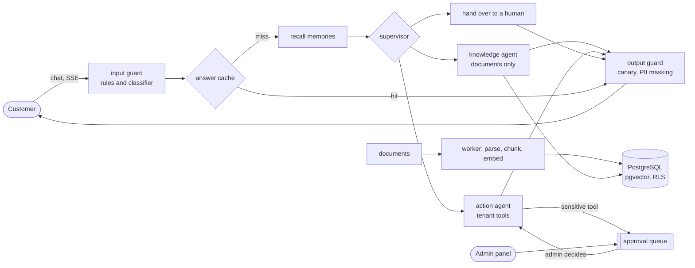

# Mabeyn

[](https://github.com/bartuonder/Mabeyn/actions/workflows/ci.yml)

**A multi-tenant support agent a business can embed with one script tag: it answers from the company's documents with citations, gets work done through the company's APIs, asks a human before anything risky, remembers returning customers, and sits behind an LLM firewall. The quality claims below are measured, and each measurement links to the file it came from.**

Built with Python 3.12, FastAPI, SQLAlchemy and Alembic, PostgreSQL 17 with pgvector, Redis and arq, LangGraph and OpenAI models; the admin panel is Next.js, everything runs with Docker Compose.


The clip above is the heart of the demo: a customer asks for a refund, the assistant stops and waits, the shop's admin reads the request and approves it, and the answer reaches the customer's chat without a reload. The full two-minute recording (a Turkish question answered from the documents, an order lookup, a blocked prompt injection and its security event) is [docs/media/demo.mp4](docs/media/demo.mp4); both are produced by `make demo-video`, see [demo/README.md](demo/README.md).

## Try it in five minutes

You need Docker and an OpenAI API key.

```bash
git clone https://github.com/bartuonder/Mabeyn.git && cd Mabeyn
cp .env.example .env        # add OPENAI_API_KEY
make demo                   # services, migrations, a demo shop, 32 documents, 5 tools
```

Then open the storefront at <http://localhost:9100>, pick a demo customer and use the chat bubble; decide approvals in the admin panel at <http://localhost:3100> (the login is printed by `make demo`). Details, API examples and the widget snippet are under [Using it](#using-it).

## What the numbers say

| What was measured | Result | Where it comes from |
| --- | --- | --- |
| Answers from the documents, 80 development questions | accuracy 0.95 [0.88-0.98], faithfulness 0.975, the right passage in the top 5 for every question | [`devfull-v7`](evals/results/20261105-232023_devfull-v7.json) |
| The same on 30 fresh held-out questions, judged by a stronger model, measured once | accuracy 0.97 [0.83-0.99], faithfulness 1.00 | [`heldout2-full`](evals/results/20261101-171719_heldout2-full.json) |
| Tool use on 15 fresh held-out scenarios | 13 of 15 passed [0.62-0.96]; no sensitive action without approval, no identity leak | [`tool-eval-heldout2`](evals/results/tool-eval-heldout2.md) |
| Memory across two sessions, 12 fresh scenarios | 11 of 12 passed [0.65-0.99]; no data of another customer, no poisoned note stored | [`memory-eval-heldout-v2`](evals/results/memory-eval-heldout-v2.md) |
| 80 attacks (injection, tool abuse, poisoned documents, exfiltration, memory poisoning) | firewall on: 0 worked [0-0.05]; firewall off: 9 worked; 1 of 80 harmless messages blocked | [`redteam-eval-after`](evals/results/redteam-eval-after.md) |
| The open `deepset/prompt-injections` test set | only 23 of 44 attacks blocked, 1 of 56 harmless blocked: the input layer is not a general jailbreak detector | [`redteam-eval`](evals/results/redteam-eval.md) |
| 50 simulated customers, answer cache off and on | knowledge questions 7.6-10 s -> 1.1 s median, $0.0016-0.0018 -> $0.0005-0.0008 per message, no failed request | [`loadtest-after`](evals/results/loadtest-after.md), [`loadtest-after-repeat`](evals/results/loadtest-after-repeat.md) |
| Pull-request evaluation gate | 20 of 20 scenarios and 29 of 30 questions pass; a deliberately broken prompt fails it | [`gate`](evals/results/gate.md) |

Intervals are 95% Wilson intervals, the sets are small, and the attacks were written by the team that wrote the defences; [docs/results.md](docs/results.md) has every table and says what each number does and does not show. Ten failures traced to their causes, fixed and not: [docs/error-analysis.md](docs/error-analysis.md). Design decisions: [docs/adr](docs/adr). How every number is produced: [docs/evaluation.md](docs/evaluation.md). Known limits are listed [below](#known-limits).

## Architecture



The assistant answers only from retrieved documents, only acts through registered tools, and never executes a sensitive action without a recorded human decision.

- Tenant isolation is enforced by PostgreSQL Row-Level Security ([ADR-0001](docs/adr/0001-row-level-security.md)), including the checkpoint and memory tables ([ADR-0008](docs/adr/0008-reaching-the-platform.md)).
- Answers cite `[document:section]`; the citation points at the section inside the retrieved chunk that holds the fact.
- The full workflow, with diagrams generated from the code, is in [docs/architecture.md](docs/architecture.md).
- Retrieval combines pgvector similarity with Turkish/English full text search (Reciprocal Rank Fusion), then an LLM reranker narrows 30 candidates to 6.
- A supervisor routes each message to a knowledge agent, an action agent or a human ([ADR-0002](docs/adr/0002-supervisor-and-two-agents.md)). Tools are registered per tenant with a JSON Schema and a risk level (`read`, `write`, `sensitive`); the platform, not the model, supplies the customer identity.
- `sensitive` tools such as refunds never run directly: the graph pauses, an admin approves or rejects, and the paused conversation survives restarts. Walk-through: [docs/demo-scenarios.md](docs/demo-scenarios.md).
- An LLM firewall guards four places ([ADR-0003](docs/adr/0003-defense-layers.md)): customer messages (rules and a small-model rating), uploaded documents (flagged passages never reach retrieval), tool calls (allowlist, refund checked against the real order, rate limit) and replies (canary token, personal data masking). Every block is a security event the admin can read.
- Returning customers are recognised: long conversations are summarised inside a token budget, and facts a customer states about themselves (a preferred carrier, an earlier complaint) are kept for 180 days in a store scoped to the customer. Instructions, permissions and personal data are never stored, and customers and admins can read and erase everything ([ADR-0006](docs/adr/0006-customer-memory.md)).

## Using it

`make demo` (see [above](#try-it-in-five-minutes)) needs only Docker and an OpenAI API key; [uv](https://docs.astral.sh/uv/) is needed only to run the tests and evaluations. The demo admin is `admin@kargoshop.example` with the password `demo-admin-password` (set `DEMO_ADMIN_PASSWORD` before the first run to change it; an existing tenant keeps its password). The same steps by hand:

```bash
docker compose up -d --build         # api, worker, mock shop, postgres (pgvector), redis; migrations run first
docker compose --profile seed run --rm seed
```

Create a customer session and chat (streaming Server-Sent Events):

```bash
TOKEN=$(curl -s -X POST localhost:8000/auth/login -H 'content-type: application/json' \
  -d '{"email": "admin@kargoshop.example", "password": "demo-admin-password"}' | jq -r .access_token)
KEY=$(curl -s -X POST localhost:8000/api-keys -H "Authorization: Bearer $TOKEN" \
  -H 'content-type: application/json' -d '{"name": "widget"}' | jq -r .key)
SESSION=$(curl -s -X POST localhost:8000/sessions -H "X-API-Key: $KEY" \
  -H 'content-type: application/json' -d '{"customer_id": "customer-1"}' | jq -r .token)
curl -N -X POST localhost:8000/chat -H "Authorization: Bearer $SESSION" \
  -H 'content-type: application/json' -d '{"message": "How long does delivery to KKTC take?"}'
```

Close the conversation to let the assistant remember what was said, and look at or erase the notes:

```bash
curl -X POST localhost:8000/chat/<conversation_id>/close -H "Authorization: Bearer $SESSION"
curl localhost:8000/me/memory -H "Authorization: Bearer $SESSION"
curl -X DELETE localhost:8000/me/memory -H "Authorization: Bearer $SESSION"
```

API keys come in two kinds ([ADR-0005](docs/adr/0005-customer-session-trust.md)). Secret keys (`"kind": "secret"`, the default) stay on the tenant's server and open sessions for a named customer, as above. Publishable keys (`"kind": "publishable"`, optionally with `allowed_origins`) are safe in a browser but only open anonymous sessions: `POST /sessions` with `{}` returns a token for `anon:<random>` that gets no memory and no customer tools.

Admins use `GET` and `DELETE /customers/{customer_id}/memory` for the same, for example to answer a deletion request.

Documents are added with `POST /documents` (PDF, Markdown, HTML upload) or `POST /documents/url`. Tools are managed with `POST /tools` and `DELETE /tools/{id}` (a tool can carry `policies` that check its arguments against a real record, see [ADR-0003](docs/adr/0003-defense-layers.md)); pending refunds are listed with `GET /approvals?status=pending` and decided with `POST /approvals/{id}`. Set `PUT /settings/notifications` with an `approval_webhook_url` to get a signed `approval.pending` event for every new request.

### Admin panel

<http://localhost:3100> (Next.js, `apps/admin`) is where a tenant admin runs the assistant: decide pending approvals (with the arguments, the customer and the conversation next to the decision), upload and delete documents and watch them being processed, register tools with their argument policies, read the security events and tune the firewall and the approval webhook, browse conversations (and erase what the assistant remembers about a customer), see usage and cost per day, clear the answer cache, and manage API keys. Sign in with the demo admin login that `make demo` prints.

The panel talks to the API only from its own server, with the admin's tokens kept in httpOnly cookies (an expired access token is renewed with the refresh token before a page renders), so the browser never sees a token and the API needs no CORS rule for it. It is built in Docker, so the machine needs no Node. `make admin-e2e` drives it in a real headless Chromium: sign-in with a wrong and a right password, a refund that a customer asked for and the admin approves, a document upload that is processed and deleted, a tool created and rejected for invalid JSON (the typed fields stay), the firewall and webhook settings, an API key created and revoked, and sign-out.

### Chat widget and demo storefront

`make demo` also starts a fictional shop at <http://localhost:9100>. Pick a demo customer in the header and open the chat bubble: a visitor gets an anonymous session, a signed-in customer gets order lookups, refunds that wait for a human, and memory. Approve the refund in the admin panel and the answer appears in the widget by itself.

A tenant embeds the widget with one script tag. For anonymous visitors use a publishable key (it is safe in a page and checks the site's origin):

```html
<script src="https://YOUR-API/widget.js" data-key="mbn_pub_..." async></script>
```

For signed-in customers the shop's own server opens the session with its secret key and the page points the widget at that endpoint (see `apps/kargoshop_site`):

```html
<script src="https://YOUR-API/widget.js" data-session-url="/support/session" async></script>
```

The widget streams answers, shows the sources an answer cites, lets the customer start a new chat (which stores what is worth remembering) and keeps the conversation across page loads. Optional attributes: `data-title`, `data-greeting`, `data-color`, `data-api`. The API allows browser calls from any origin because every call carries a bearer token or key and never a cookie (`CORS_ALLOW_ORIGINS` narrows it). `make widget-e2e` drives the whole walk-through in a real headless Chromium and leaves screenshots in `tests/e2e/shots`.

## Development

```bash
uv sync
docker compose up -d postgres redis
make migrate
make test lint typecheck
```

Tests and evaluations send traces to LangSmith when `.env` enables tracing; tests switch it off themselves, and `LANGSMITH_TRACING=false` silences it for a single run (useful once the monthly trace quota of a free account is used up).

## Results

Each row of the table near the top links to the file it came from. [docs/results.md](docs/results.md) has the full tables (the retrieval ablation, the held-out sets, tool use, memory, the red-team and firewall runs, cache, load tests and the evaluation gate) and says for each what it does and does not show. Three things worth knowing before you trust any of them: the held-out sets were measured once and never tuned on, the sets are small (see the intervals), and the attacks were written by the people who wrote the defences. [docs/error-analysis.md](docs/error-analysis.md) traces ten failures to their causes.

## Known limits

- The input layer of the firewall is not a general jailbreak detector: it blocked 23 of 44 attacks of an open prompt-injection set. Rules and the classifier catch known phrases and context-dependent triggers, not every paraphrase.
- The small models that grade passages and verify answers are the weak point of answer quality: they sometimes drop the passage that answers a question or reject a correct answer ([error analysis](docs/error-analysis.md)).
- Argument policies check one record per call (a lookup, then equality, amount and date checks).
- An approval webhook is the only notification channel, and a human colleague has no endpoint yet to answer an escalated conversation.
- A customer's identity is only as trustworthy as the API key that opened the session ([ADR-0005](docs/adr/0005-customer-session-trust.md)).
- The demo is meant for a local machine: default passwords and secrets are for the demo only, there is no TLS or deployment configuration, and the load tests are one-machine comparisons, not capacity figures.

The full list is in [docs/architecture.md](docs/architecture.md#13-known-limitations).

## Repository layout

| Path | What it holds |
| --- | --- |
| `mabeyn/` | The core packages: `agents` (supervisor, action agent, approvals), `rag`, `guard` (the firewall), `memory`, `cache`, `tools`, `ingestion`, `db`, `llm` |
| `apps/api`, `apps/worker` | The FastAPI service and the background worker (ingestion, memory extraction, approval expiry and notification) |
| `apps/admin` | The admin panel (Next.js) |
| `apps/kargoshop_mock`, `apps/kargoshop_site` | The demo shop's backend and storefront with the chat widget |
| `evals/` | Datasets, runners, the pull-request gate and every result file |
| `loadtest/`, `demo/` | The load test and the recorded demo |
| `migrations/`, `seed/` | Database migrations and the demo tenant's documents, tools and orders |
| `docs/` | [Architecture](docs/architecture.md), [design decisions](docs/adr), [evaluation method](docs/evaluation.md), [results](docs/results.md), [error analysis](docs/error-analysis.md), [demo scenarios](docs/demo-scenarios.md), [roadmap](docs/ROADMAP.md) |
