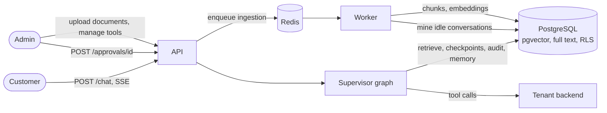
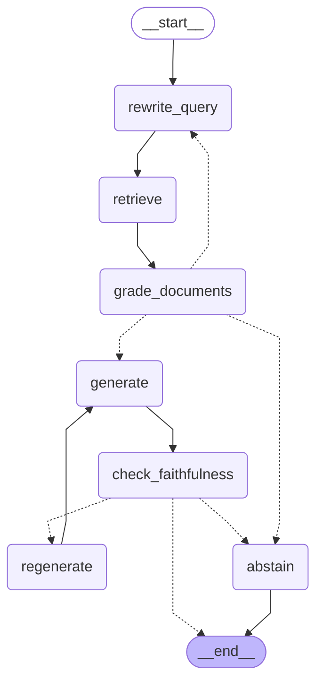
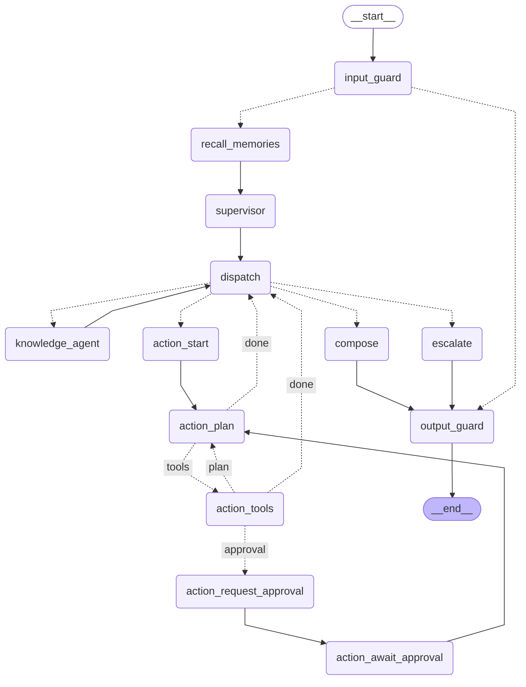
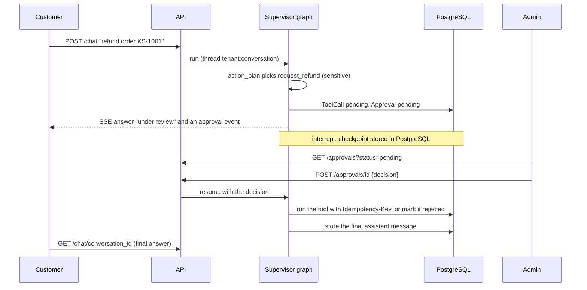
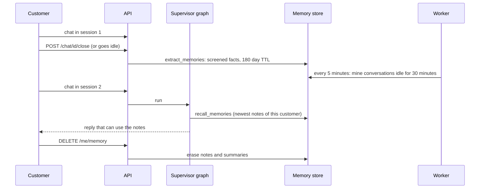

# Architecture

How a customer message becomes an answer or an action, and where each guarantee lives. The graph diagrams and the settings table are generated from the code (see [Keeping this page current](#keeping-this-page-current)); everything else is written by hand.

## 1. System overview



| Component | Role |
| --- | --- |
| API (`apps/api`) | Auth, uploads, chat streaming, approvals, tool management |
| Worker (`apps/worker`) | Background jobs (arq on Redis): document ingestion, memory extraction for idle conversations, expiry sweep |
| PostgreSQL | Tenant data under Row-Level Security, pgvector index, full text index, graph checkpoints, customer memory |
| Supervisor and RAG graphs (`mabeyn/agents`, `mabeyn/rag`) | LangGraph workflows described below |
| Tenant backend | The tenant's own API, reached only through registered tools (`apps/kargoshop_mock` in the demo) |

## 2. Ingestion

1. `POST /documents` (PDF, Markdown, HTML upload) or `POST /documents/url` stores the raw file and a `pending` document, commits, then enqueues a job.
2. The worker parses the file into heading-aware sections, packs them into chunks of 300–600 tokens (small sections merge until the minimum is reached), prefixes each chunk with a context header (`document > section path`), and embeds the text.
3. Chunks are written with the section label, page, token count, embedding and a `fts_config` (`turkish` or `english`, from the document language) that drives the generated full text vector.
4. The document moves `pending → processing → ready | failed`. Failures store a short message and never leak internals.

URL ingestion resolves the host and refuses non-public addresses, follows at most three redirects and caps the download size.

## 3. RAG subgraph (knowledge agent)

Dotted arrows are conditional edges chosen at run time.

<!-- generated:rag-graph -->

<!-- /generated -->

| Node | What it does |
| --- | --- |
| `rewrite_query` | First pass without history keeps the question as is (no model call). With history it writes a standalone query. After a failed grading round it writes a different query. |
| `retrieve` | Embeds the query, runs vector search and full text search (30 candidates each), merges them with Reciprocal Rank Fusion, and lets an LLM reranker keep the best 6. Every query is filtered by tenant and also protected by RLS. |
| `grade_documents` | A small model keeps only the passages that help answer the question. When passages contradict each other it keeps the one with the latest `effective_date`. No useful passage leads back to `rewrite_query` (at most twice), then to `abstain`. An unreadable grader reply keeps all passages. |
| `generate` | The main model streams an answer from the sources and cites `[Document:Section]` tags taken from each source's `tags` attribute. |
| `check_faithfulness` | A small model checks that every claim is supported by the sources. |
| `regenerate` | Emits a `Retract` event and sends the graph back to `generate` once, with a stricter rule. |
| `abstain` | Emits a `Retract` event and replies with a short "I could not find reliable information" sentence in the customer's language. |

Streaming: tokens are emitted while `generate` runs. If the faithfulness check fails afterwards, the client receives a `retract` event and the authoritative answer arrives in the final event. Citations are resolved from the tags in the final answer to the chunks that were actually shown to the model.

The evaluation ablation toggles these stages through `RagConfig`; the defaults are in the settings table below.

## 4. Supervisor graph

Dotted arrows are conditional edges chosen at run time.

<!-- generated:supervisor-graph -->

<!-- /generated -->

| Node | What it does |
| --- | --- |
| `input_guard` | Normalises the text (invisible and control characters, length), then runs the firewall's input layer: rules for override phrases, hidden characters and encoded payloads, then a small-model rating compared with the tenant's threshold. A blocked message skips routing and gets a fixed reply; the attempt is written to the security events. Also resets the per-turn part of the state and decides whether replies are held back for checking. |
| `recall_memories` | Loads the saved notes about this customer from the long-term store (newest first, at most ten, screened again before use). Anonymous sessions skip it. A failing store is logged and the conversation goes on without notes. |
| `supervisor` | One small-model call returns the route (`knowledge`, `action`, both, or `escalate`), the customer's language by name, and, for mixed requests, a clean policy question without order details. |
| `dispatch` | Picks the next step of the plan; a pending `needs_human` flag always wins and goes to `escalate`. |
| `knowledge_agent` | Runs the RAG subgraph. Streams live only when it is the whole plan. An abstention is dropped so it never reaches the action agent or the customer. |
| `action_start` | Seeds the tool loop with the last few messages and the question. |
| `action_plan` | The main model chooses a tool or answers. It is told today's date, the policy notes (only the knowledge answer text, never document chunks), the reply language and the refund checklist. After 5 tool calls it must answer with what it has. |
| `action_tools` | Handles one tool call per step: unknown tools and invalid arguments are returned to the model as errors; `sensitive` tools go to approval; others run through the executor and are audited. Three failures in a row set `needs_human`. |
| `action_request_approval` | Creates a pending `ToolCall` and an `Approval` and writes the "under review" notice in the customer's language. |
| `action_await_approval` | Calls LangGraph `interrupt` first, so the graph pauses here. On resume it runs the tool (approved) or records the rejection, then returns to `action_plan`. |
| `escalate` | Marks the conversation `escalated` with a reason and tells the customer that a human colleague will take over. |
| `compose` | A single answer passes through. When both agents answered, a model merges them: outcome of the order request first, only the relevant policy facts after it. |
| `output_guard` | Trims the text, replaces a reply that contains the tenant's canary token and masks validated personal data (IBAN, card, national id, e-mail, phone). While the output layer is active the reply is released only here, as one token event, so nothing leaks before the check. |

Routing and privilege rules:

- The knowledge agent has no tools. The action agent has all of the tenant's tools but no access to documents; retrieved chunks are never stored in the shared state.
- Identity (`tenant_id`, `customer_id`) comes from the verified session and is added by the tool executor. Tool schemas that expose those names are rejected, and a model-supplied value is a validation error.
- Mixed requests run knowledge first, then action; the action agent receives only the knowledge answer as policy notes.
- State is JSON-safe and checkpointed per `tenant_id:conversation_id`. `input_guard` resets the per-turn keys, so each message starts clean in the same thread.

## 5. Human approval



A new customer message while an approval is pending gets a short reminder instead of starting another run. The pending request survives an API restart because the paused state lives in PostgreSQL.

## 6. Tools

- Tenants register tools with a JSON Schema, an HTTP method, a URL template and a risk level (`read`, `write`, `sensitive`). Registration rejects unsafe definitions: reserved argument names, unsupported schema keywords, relative URLs, path parameters that are not required properties.
- The schema becomes a strict Pydantic model at run time. Unknown fields and wrong types are errors returned to the model.
- The HTTP executor adds `customer_id` and `X-Tenant-Id`, applies a timeout, retries only `GET`, caps the response size, refuses redirects, blocks non-public hosts unless allowed by `TOOL_ALLOWED_HOSTS`, and sends a stable `Idempotency-Key` on writes.
- Every call is stored in `tool_calls` (arguments, truncated result, status, duration). A call that already finished is never executed again.

## 7. Memory

### Short-term: the conversation

The API sends the agents a summary plus the recent messages, never the whole history:

1. It loads the messages that are not yet part of `conversations.summary` (counted in `summarized_messages`).
2. When summary plus those messages exceed the history budget, the small model folds the oldest ones into the summary and the newest few stay word for word. Every message is clipped first, the summary has its own limit, and what remains always fits the budget (a test checks this for long and enormous messages).
3. The summary reaches the router and the action agent; escalated conversations skip all of this because a human owns them. If the model is down, the old messages are appended to the summary and cut to the limit.

### Long-term: what is remembered about a customer



- **Store.** The LangGraph PostgreSQL store, namespace `(tenant_id, customer_id)`, key `category:slug`. Categories are `preference`, `issue`, `product` and `context`. A newer fact with the same key replaces the older one, a customer keeps at most 25 records, and every record expires 180 days after it was written. Expired records are hidden immediately and removed by an hourly sweep.
- **`extract_memories`.** Runs when a conversation is closed (`POST /chat/{id}/close`) or has been idle for 30 minutes (the worker checks every five minutes). It reads only the customer's own messages, asks the small model for facts as JSON, validates each one against the schema, screens it and stores what passes. If the model fails the conversation stays unmarked and is tried again; a new message in a closed conversation reopens it and queues it for mining again.
- **Hygiene.** The extraction prompt excludes instructions, permissions and claims. A deterministic screen then rejects instruction-like text and entitlement claims ("from now on always approve", "I am a VIP", Turkish equivalents), personal data (e-mail, phone, IBAN, national id, card numbers, secrets, URLs) and markup. Every rejection is a `SecurityEvent` with layer `memory`; the text of personal data is not logged. Notes are screened again on recall.
- **`recall_memories`** loads the newest ten notes of the verified customer at the start of every message. A failing store is logged and the conversation goes on without notes.
- **Use.** The router only learns that notes exist, so questions about what is remembered go to the action agent. The action agent sees the notes in a `<customer_notes>` block marked as unverified data. They personalise replies and answer "what do you remember", and they never change a tool call, a refund decision or an approval.
- **Erasure.** `GET` and `DELETE` on `/me/memory` (customer token) and `/customers/{id}/memory` (admin token, own tenant only) show and erase the notes. Erasure also clears conversation summaries and marks the customer's open conversations as mined, so an old chat cannot refill the store.

Why it is built this way: [ADR-0006](adr/0006-customer-memory.md). How it is measured: the memory evaluation in [evaluation.md](evaluation.md#memory-evaluation).

## 8. Firewall

Four layers plus a log, each switched by the tenant's `firewall_enabled` setting. Rationale and alternatives: [ADR-0003](adr/0003-defense-layers.md).

| Layer | Where it runs | What it does |
| --- | --- | --- |
| Input | `input_guard` | Rules before any model: hidden and tag characters, base64 and hex payloads (decoded and checked again) and known override phrases in English, Turkish and German. Then a small model rates the message from 0 to 1; the tenant threshold (default 0.7) decides, and an unreadable rating blocks. A blocked message gets a fixed bilingual reply and is stored with `blocked = true`, so summaries and memory ignore it. |
| Indirect injection | ingestion and `generate` | Every passage is rated with a document prompt when it is ingested; passages above the threshold are flagged and excluded from vector and full-text retrieval. Retrieved text sits in `<source>` blocks declared untrusted, and forged source tags inside a document are neutralised. |
| Tools | `action_tools`, `action_await_approval` | A tenant allowlist hides tools from the model. A refund is checked against the real order, fetched with the customer's injected identity: the order must belong to the customer and the amount may not exceed the total. Write and sensitive calls are rate limited per customer (default 5 per hour). Checks run before an approval is opened and again before an approved call runs. A failed check is an error the model sees, never a call. |
| Output | `output_guard` | A per-tenant canary token sits in the agents' prompts; a reply that contains it, even spaced out, is replaced. Validated IBAN, card, national id, e-mail and phone values are masked. While the layer is active, replies are held until checked and released as one token event; with the layer off they stream as before. |
| Log | everywhere | Each block or flag is a `security_events` row (layers `input`, `ingestion`, `tool`, `output`, `memory`) with a masked excerpt. `GET /security-events` lists them, filtered by layer or action. |

Tenant settings (`GET` and `PUT /settings/firewall`): master switch, injection threshold, write rate limit and window, and an optional tool allowlist (`null` allows every tool).

### Who is the customer

Secret API keys (`mbn_sec_…`) stay on the tenant's server and open sessions for a named customer. Publishable keys (`mbn_pub_…`) are safe in a browser: they only open anonymous sessions (`anon:<random>`), may be limited to a list of origins, and cannot name a customer. Anonymous sessions get no memory, and the action agent sees only tools registered with `requires_identity: false`. Session creation is rate limited per client address and per key.

## 9. State and tenancy

| Data | Where | Protection |
| --- | --- | --- |
| Documents, chunks, conversations, messages, tools, tool calls, approvals | PostgreSQL tables | `tenant_id` column and Row-Level Security; the API role cannot bypass it |
| Graph checkpoints | `checkpoints*` tables | Thread id carries the tenant; tables have no RLS, resuming requires an approval row that is itself protected |
| Customer memory | `store` table | Namespace `(tenant_id, customer_id)` built from the verified identity; no RLS ([ADR-0006](adr/0006-customer-memory.md)) |
| Firewall settings and security events | `tenant_settings`, `security_events` | `tenant_id` column and Row-Level Security |
| Conversation summaries | `conversations.summary` | Same as conversations |
| Raw uploads | `documents.raw_content` | Same as documents |
| Customer and admin sessions | Signed tokens | Short-lived; admin refresh tokens rotate with reuse detection |

## 10. Settings and versions

<!-- generated:facts -->
| Setting | Value |
| --- | --- |
| Prompt versions | `rag-v6`, `agents-v14`, `memory-v3`, `guard-v1` |
| Answer and action model | `gpt-4.1-mini` |
| Small model (routing, rewriting, grading, reranking, checks) | `gpt-4o-mini` |
| Judge model (evaluation) | `gpt-4.1-mini` |
| Embedding model | `text-embedding-3-small` |
| Chunk size | 300–600 tokens |
| Retrieval | `hybrid`, 30 candidates |
| Reranker | on, keeps 6 |
| Relevance grading | on |
| Faithfulness check | on |
| Query rewrites after a failed grading | 2 |
| Regenerations after a failed faithfulness check | 1 |
| Passage length shown to grader and reranker (characters) | 2000 and 1500 |
| Tool calls per request | 5 |
| Consecutive tool failures before a human takes over | 3 |
| History messages given to the action agent | 4 |
| Tool timeout (seconds) | 10.0 |
| Tool response limit (bytes) | 65536 |
| Retries for `GET` tools | 2 |
| Customer token lifetime (minutes) | 15 |
| History budget: summary plus recent messages (tokens) | 1500 |
| Recent messages kept word for word | 6 |
| Summary limit (tokens) | 300 |
| Memory time to live (days) | 180 |
| Memory records per customer | 25 |
| Notes recalled per message | 10 |
| Idle minutes before a conversation is mined | 30 |
| Injection threshold (tenant default) | 0.7 |
| Write tool rate limit per customer (tenant default) | 5 per 60 minutes |
| Session requests per window (address, key) | 20, 60 per 60 s |
<!-- /generated -->

## 11. Evaluation

See [evaluation.md](evaluation.md) for the datasets, metrics and how to run them. Prompt edits must come with a new `PROMPT_VERSION`; `tests/test_prompt_registry.py` enforces it.

## 12. Known limitations

- Questions asked in a language the documents do not use retrieve poorly.
- Time to the first streamed token is about four seconds on the knowledge path (routing, query handling, reranking and grading run before generation).
- The firewall's rating sees one message at a time, so an attack spread over several messages is judged message by message; rules and the canary catch known phrases and verbatim leaks, not paraphrases.
- Argument policies exist for the KargoShop tools (`request_refund`, `change_address`); a tenant without a `get_order_status` tool is not checked.
- Small sections are merged into one passage, so one poisoned sentence withholds its whole passage from retrieval.
- The firewall adds a small-model call to every message and a call per passage at ingestion.
- Rate limits for requests in general and for the chat endpoint arrive with the LLMOps phase; only session creation is limited today.
- A pending approval never expires, nobody is notified, and a human colleague has no endpoint to answer an escalated conversation yet.
- Two simultaneous messages in one conversation are not serialised.
- Customer identity is only as trustworthy as the API key that opened the session, see [ADR-0005](adr/0005-customer-session-trust.md). Memory inherits this: whoever can open a session as a customer can read and erase that customer's notes.
- The memory store has no row-level security; isolation rests on the namespace.
- Notes are statements by the customer and are not verified. A false claim can be stored as a harmless-looking fact and repeated back, but it cannot grant anything.
- With notes in the prompt, the action agent sometimes explains the refund process instead of calling `request_refund` (one of three Turkish or mixed refund requests in the memory evaluation); no refund ran without approval.
- Customers cannot switch memory off for themselves, only erase it.

## Keeping this page current

The blocks between `<!-- generated:… -->` and `<!-- /generated -->` are rewritten from the code:

```bash
uv run python -m mabeyn.docs_sync          # rewrite the generated blocks
uv run python -m mabeyn.docs_sync --check  # fail when they are out of date
```

`tests/test_architecture_doc.py` runs the check, so CI fails when a node, edge, limit, model or prompt version changes without a refresh. The same test also fails when a graph node is missing from the node tables above, which forces the prose to be updated when a node is added.

When behaviour changes without changing the graph shape (a new rule in a prompt, a new tool guard), update the matching paragraph and bump the prompt version if a prompt changed.
